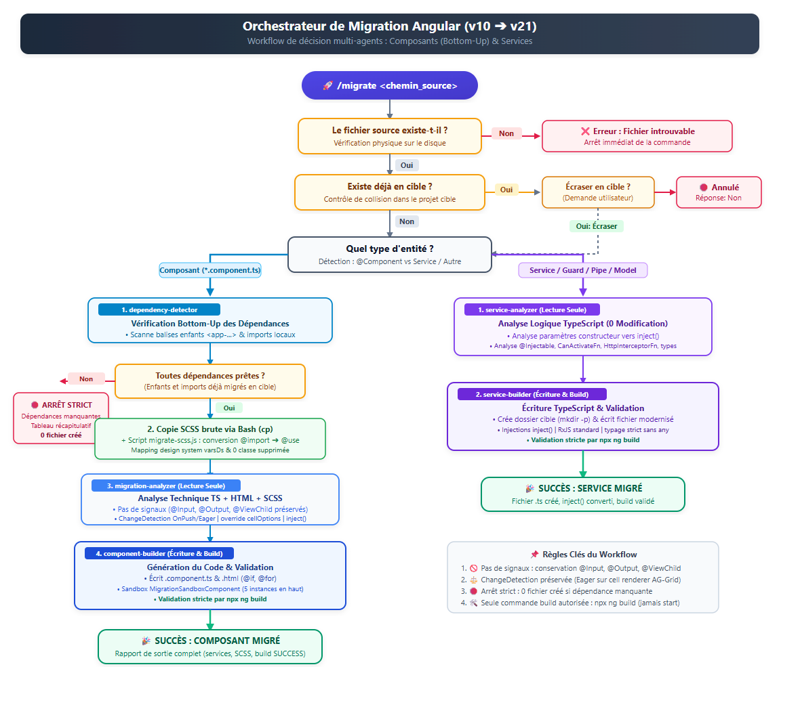
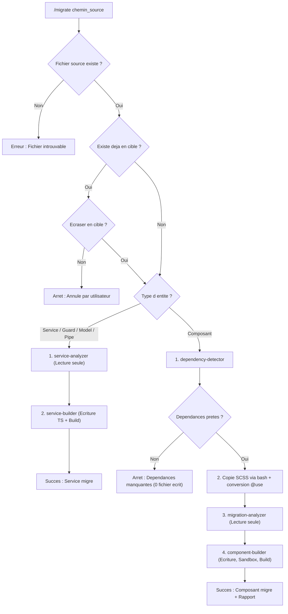

# Architecture Multi-Agents de Migration Angular (v10 -> v21)
### Approche Bottom-Up : Composants, Services, Pipes, Directives, Guards & Modèles

Ce système pour **Claude Code** automatise la migration d'éléments Angular depuis une ancienne base de code (Angular 10) vers un nouveau projet moderne (Angular 21), selon une approche **Bottom-Up rigoureuse** (un élément à la fois).

> 🎯 **RÈGLE DU FICHIER UNIQUE** :
> Chaque exécution traite **uniquement le fichier spécifié**.
> Si **ne serait-ce qu'une seule dépendance requise** n'est pas encore migrée dans le nouveau projet, **la commande s'arrête net** et fournit un rapport détaillé sans toucher au disque.

---

## 📊 Schéma de Décision (Workflow)



<details>
<summary><b>📋 Afficher le schéma en version texte (ASCII)</b></summary>

```text
/migrate <chemin_source>
   │
   ▼
[ Fichier source existe ? ] ────(Non)────► [ ❌ Erreur : Fichier source introuvable ]
   │ (Oui)
   ▼
[ Existe déjà en cible ? ] ─────(Oui)────► [ Écraser ? ] ────(Non)────► [ 🛑 Annulé par l'utilisateur ]
   │ (Non)                                     │ (Oui)
   └─────────────────────┬─────────────────────┘
                         ▼
             [ Quel type d'entité ? ]
                         │
        ┌────────────────┴────────────────────────┐
        ▼                                         ▼
  [ CAS A : COMPOSANT ]                 [ CAS B : SERVICE / AUTRE ]
        │                                         │
        ▼                                         ▼
  [ 1. dependency-detector ]            [ 1. service-analyzer ]
  (Scan enfants & imports)              (Lecture seule : 0 modification)
        │                               • Analyse constructeur pour inject()
        ▼                               • Analyse flux RxJS et types
  [ Dépendances prêtes ? ]                        │
        │                                         ▼
        ├─(Non)─► [ 🛑 ARRÊT STRICT ]   [ 2. service-builder ]
        │         (Dépendances manquantes,        • Crée dossier cible (mkdir -p)
        │          0 fichier créé)                • Écrit le fichier modernisé
        ▼ (Oui)                                   • Valide avec npx ng build
  [ 2. Copie SCSS via bash ]                      │
    + script @import -> @use                      ▼
        │                               [ ✅ SUCCÈS : SERVICE MIGRÉ ]
        ▼
  [ 3. migration-analyzer ]
  (Lecture seule : 0 modification)
  • Plan TS + HTML + SCSS
  • Pas de signaux, OnPush/Eager
        │
        ▼
  [ 4. component-builder ]
  • Écrit .component.ts & .html
  • Sandbox (5 instances en haut)
  • Valide avec npx ng build
        │
        ▼
  [ ✅ SUCCÈS : COMPOSANT MIGRÉ + RAPPORT ]
```

</details>

<details>
<summary><b>📊 Code source Mermaid</b></summary>



</details>

---

## 🔀 Branching Spécialisé : Équipe Composants vs Équipe Services

L'orchestrateur détecte automatiquement le type d'artefact et mobilise l'équipe d'agents dédiée avec une stricte séparation entre **Analyse (Lecture seule, 0 modification)** et **Reconstruction (Écriture & Build)** :

| Type d'Entité | Détection | Étape 1 : Analyse (Lecture Seule) | Étape 2 : Reconstruction & Build |
| :--- | :--- | :--- | :--- |
| **Composant** (`*.component.ts`) | `@Component` | 🕵️ `dependency-detector`<br>🔍 `migration-analyzer` (`analyze-migration`) *(Ne modifie rien)* | 🔨 `component-builder` (`rebuild-component`) : TS + HTML, Sandbox (5 instances), SCSS `@use`, `npx ng build`. |
| **Service & Logique** (`*.service.ts`, `*.guard.ts`, etc.) | `@Injectable`, `CanActivate`, etc. | 🔍 `service-analyzer` (`analyze-service`) *(Ne modifie rien, juste analyse)* | ⚡ `service-builder` (`rebuild-service`) : Écriture TS modernisé, `npx ng build`. *(Pas de SCSS, pas de template, pas de Sandbox)* |

---

## 📁 Organisation des Fichiers

```text
.
├── .claude/
│   ├── commands/
│   │   └── migrate.md              # 🎯 Commande utilisateur unique (/migrate)
│   ├── agents/
│   │   ├── orchestrator.md         # 🎩 Agent Orchestrateur principal
│   │   ├── dependency-detector.md  # 🕵️ Sous-Agent Composant 1 : Dépendances Enfants & Imports
│   │   ├── migration-analyzer.md   # 🔍 Sous-Agent Composant 2 : Analyse TS/HTML/SCSS (Lecture seule)
│   │   ├── component-builder.md    # 🔨 Sous-Agent Composant 3 : Reconstruction, Sandbox, Build & Rapport
│   │   ├── service-analyzer.md     # 🔍 Sous-Agent Service 1 : Analyse technique (Lecture seule, 0 modification)
│   │   └── service-builder.md      # ⚡ Sous-Agent Service 2 : Reconstruction TS & Build
│   └── skills/
│       ├── detect-dependencies.md  # 🧠 Skill : Détection Bottom-Up (Composants)
│       ├── analyze-migration.md    # 🧠 Skill : Règles Composant (No signals, Eager/OnPush, SCSS @use)
│       ├── rebuild-component.md    # 🧠 Skill : Reconstruction Composant, Sandbox & Build
│       ├── analyze-service.md      # 🧠 Skill : Analyse Services, Guards, Pipes & Modèles (Lecture seule)
│       └── rebuild-service.md      # 🧠 Skill : Reconstruction Service & Validation Build
├── scripts/
│   ├── detect-dependencies.js      # ⚙️ Utilitaire déterministe d'analyse des dépendances
│   └── migrate-scss.js             # 🎨 Utilitaire de conversion SCSS (@import -> @use varsDs)
└── README.md
```

---

## 🧪 Démonstrateur Sandbox & Validation de Build

Pour chaque composant migré :
1. **Mise à jour de `MigrationSandboxComponent`** (`src/app/migration-sandbox/migration-sandbox.ts` et `.html`) :
   - Au moins **5 instances différenciantes** ajoutées en haut de page.
   - Utilisation des vrais constructeurs positionnels (`new SelectOptions(...)`, `new LookupOptions(...)`) — **jamais de `as unknown as XxxOptions`**.
2. **Validation stricte par `npx ng build`** :
   - Exécution de `npx ng build` (jamais `npm start`).
   - Correction automatique et itération jusqu'à compilation réussie (`Application bundle generation complete`).
3. **Rapport final structuré** :
   - Composants migrés, services injectés via `inject()`, statut du build, rapport SCSS détaillé.

---

## 🚀 Exemples d'Utilisation dans Claude Code

### Exemple 1 : Migrer un Service (Équipe Services : `service-analyzer` ➔ `service-builder`)
```bash
/migrate /chemin/absolu/vers/legacy-project/sources/frontend/src/app/core/services/auth.service.ts
```

### Exemple 2 : Migrer un Composant (Équipe Composants : `dependency-detector` ➔ `migration-analyzer` ➔ `component-builder`)
```bash
/migrate /chemin/absolu/vers/legacy-project/sources/frontend/src/app/shared/cells/mon-composant/mon-composant.component.ts
```
