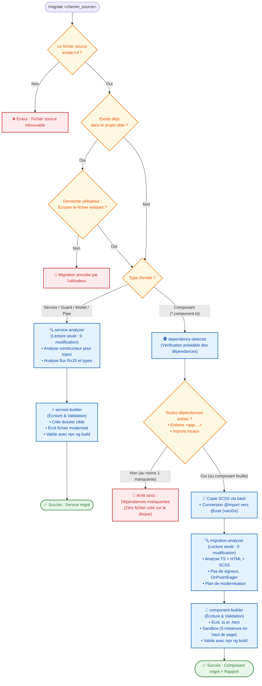

# Architecture Multi-Agents de Migration Angular (v10 -> v21)
### Approche Bottom-Up : Composants, Services, Pipes, Directives, Guards & Modèles

Ce système pour **Claude Code** automatise la migration d'éléments Angular depuis une ancienne base de code (Angular 10) vers un nouveau projet moderne (Angular 21), selon une approche **Bottom-Up rigoureuse** (un élément à la fois).

> 🎯 **RÈGLE DU FICHIER UNIQUE** :
> Chaque exécution traite **uniquement le fichier spécifié**.
> Si **ne serait-ce qu'une seule dépendance requise** n'est pas encore migrée dans le nouveau projet, **la commande s'arrête net** et fournit un rapport détaillé sans toucher au disque.

---

## 📊 Schéma de Décision (Workflow)



---

## 🔀 Branching Spécialisé : Équipe Composants vs Équipe Services

L'orchestrateur détecte automatiquement le type d'artefact et mobilise l'équipe d'agents dédiée avec une stricte séparation entre **Analyse (Lecture seule, 0 modification)** et **Reconstruction (Écriture & Build)** :

| Type d'Entité | Détection | Étape 1 : Analyse (Lecture Seule) | Étape 2 : Reconstruction & Build |
| :--- | :--- | :--- | :--- |
| **Composant** (`*.component.ts`) | `@Component` | 🕵️ `dependency-detector`<br>🔍 `migration-analyzer` (`analyze-migration`) *(Ne modifie rien)* | 🔨 `component-builder` (`rebuild-component`) : TS + HTML, Sandbox (5 instances), SCSS `@use`, `npx ng build`. |
| **Service & Logique** (`*.service.ts`, `*.guard.ts`, etc.) | `@Injectable`, `CanActivate`, etc. | 🔍 `service-analyzer` (`analyze-service`) *(Ne modifie rien, juste analyse)* | ⚡ `service-builder` (`rebuild-service`) : Écriture TS modernisé, `npx ng build`. *(Pas de SCSS, pas de template, pas de Sandbox)* |

---

## 🏛️ Hiérarchie Commande ➔ Orchestrateur ➔ Sous-Agents & Skills

```text
Utilisateur
  │
  ▼
[ Commande : /migrate <chemin_source> ]
  │
  ▼
[ 🎩 Agent ORCHESTRATEUR (orchestrator.md) ]
  ├── 1. Valide le chemin source & vérifie l'existence en cible (demande d'écraser ?)
  │
  ├── 2. Aiguillage selon le type de fichier :
  │      │
  │      ├─► [ CAS A : COMPOSANT (*.component.ts) ] ➔ Équipe Composant
  │      │   │
  │      │   ├── 🕵️ Sous-Agent : dependency-detector (scan enfants + imports, arrêt strict)
  │      │   ├── 🎨 Copie SCSS via bash + conversion @import ➔ @use (varsDs)
  │      │   ├── 🔍 Sous-Agent : migration-analyzer [LECTURE SEULE : 0 MODIFICATION]
  │      │   │   • Produit le plan TS + HTML + SCSS (No signals, Eager/OnPush, base classe override)
  │      │   └── 🔨 Sous-Agent : component-builder [ÉCRITURE & VALIDATION]
  │      │       • Génère .component.ts et .component.html
  │      │       • Met à jour MigrationSandboxComponent (5 instances en haut de page)
  │      │       • Valide avec npx ng build & produit le rapport
  │      │
  │      └─► [ CAS B : SERVICE / MODEL / GUARD / PIPE ] ➔ Équipe Service
  │          │
  │          ├── 🔍 Sous-Agent : service-analyzer [LECTURE SEULE : 0 MODIFICATION]
  │          │   • Analyse les injections du constructeur (vers inject)
  │          │   • Analyse les signatures RxJS, méthodes et types
  │          │   • Produit le récapitulatif d'analyse sans toucher au disque
  │          │
  │          └── ⚡ Sous-Agent : service-builder [ÉCRITURE & VALIDATION]
  │              • ⏭️ Aucun SCSS, aucun template HTML, aucune Sandbox
  │              • Recrée le dossier cible (mkdir -p)
  │              • Écrit le fichier TypeScript modernisé (inject, Injectable, CanActivateFn, etc.)
  │              • Valide la compilation avec npx ng build
```

---

## 📁 Organisation des Fichiers

```text
.
├── .claude/
│   ├── commands/
│   │   └── migrate.md              # 🎯 Commande utilisateur unique (/migrate)
│   ├── agents/
│   │   ├── orchestrator.md         # 🎩 Agent Orchestrateur principal
│   │   ├── dependency-detector.md  # 🕵️ Sous-Agent Composant 1 : Dépendances Enfants & Imports
│   │   ├── migration-analyzer.md   # 🔍 Sous-Agent Composant 2 : Analyse TS/HTML/SCSS (Lecture seule)
│   │   ├── component-builder.md    # 🔨 Sous-Agent Composant 3 : Reconstruction, Sandbox, Build & Rapport
│   │   ├── service-analyzer.md     # 🔍 Sous-Agent Service 1 : Analyse technique (Lecture seule, 0 modification)
│   │   └── service-builder.md      # ⚡ Sous-Agent Service 2 : Reconstruction TS & Build
│   └── skills/
│       ├── detect-dependencies.md  # 🧠 Skill : Détection Bottom-Up (Composants)
│       ├── analyze-migration.md    # 🧠 Skill : Règles Composant (No signals, Eager/OnPush, SCSS @use)
│       ├── rebuild-component.md    # 🧠 Skill : Reconstruction Composant, Sandbox & Build
│       ├── analyze-service.md      # 🧠 Skill : Analyse Services, Guards, Pipes & Modèles (Lecture seule)
│       └── rebuild-service.md      # 🧠 Skill : Reconstruction Service & Validation Build
├── scripts/
│   ├── detect-dependencies.js      # ⚙️ Utilitaire déterministe d'analyse des dépendances
│   └── migrate-scss.js             # 🎨 Utilitaire de conversion SCSS (@import -> @use varsDs)
└── README.md
```

---

## 🧪 Démonstrateur Sandbox & Validation de Build

Pour chaque composant migré :
1. **Mise à jour de `MigrationSandboxComponent`** (`src/app/migration-sandbox/migration-sandbox.ts` et `.html`) :
   - Au moins **5 instances différenciantes** ajoutées en haut de page.
   - Utilisation des vrais constructeurs positionnels (`new SelectOptions(...)`, `new LookupOptions(...)`) — **jamais de `as unknown as XxxOptions`**.
2. **Validation stricte par `npx ng build`** :
   - Exécution de `npx ng build` (jamais `npm start`).
   - Correction automatique et itération jusqu'à compilation réussie (`Application bundle generation complete`).
3. **Rapport final structuré** :
   - Composants migrés, services injectés via `inject()`, statut du build, rapport SCSS détaillé.

---

## 🚀 Exemples d'Utilisation dans Claude Code

### Exemple 1 : Migrer un Service (Équipe Services : `service-analyzer` ➔ `service-builder`)
```bash
/migrate /chemin/absolu/vers/legacy-project/sources/frontend/src/app/core/services/auth.service.ts
```

### Exemple 2 : Migrer un Composant (Équipe Composants : `dependency-detector` ➔ `migration-analyzer` ➔ `component-builder`)
```bash
/migrate /chemin/absolu/vers/legacy-project/sources/frontend/src/app/shared/cells/mon-composant/mon-composant.component.ts
```
